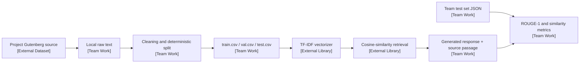

# Historical Figure Chatbot: Marcus Aurelius

An M3 university NLP project that builds a retrieval-based chatbot that responds
in the voice of Marcus Aurelius using public-domain historical text.

## Dataset and License

- **Figure:** Marcus Aurelius
- **Dataset:** *Meditations*
- **Source:** [Project Gutenberg, eBook 2680](https://www.gutenberg.org/ebooks/2680)
- **License:** Public Domain. Verify the applicable jurisdiction and Gutenberg
  notice before redistribution.
- **Acquisition:** `data/raw/marcus_aurelius_meditations.txt` contains a small
  local public-domain passage set for reproducible testing. Run
  `python src/preprocess.py --download` to replace it with the fuller
  Project Gutenberg eBook 2680 text before preprocessing.

## Team

| Team placeholder | Role |
|---|---|
| Student: Kerim Kurić | Data and preprocessing |
| Student: Viktor Polić| Evaluation and visualization |
| Student: Nedim Omerčević | Baseline and documentation |

## Installation

Run every command from the repository root in a Windows terminal.

```powershell
python -m venv .venv
.\.venv\Scripts\Activate.ps1
python -m pip install --upgrade pip
pip install -r requirements.txt
```

## Run the Pipeline

Run in this order:

```powershell
python src/preprocess.py --download
python src/eda.py
python src/baseline.py
python src/baseline.py --chat
```

The preprocess script creates `data/processed/train.csv`,
`data/processed/val.csv`, and `data/processed/test.csv` using an 80/10/10
deterministic split.

EDA creates:

- `figures/text_length_distribution.png`
- `figures/top_terms.png`

Baseline evaluation creates `figures/baseline_results.csv`.

## Pipeline



## Baseline Design

The baseline uses scikit-learn `TfidfVectorizer` with 1--2 word n-grams and
cosine similarity over processed training passages. It is deterministic and is
a retrieval baseline, not evidence that a response is factually correct or
stylistically authentic.

```powershell
python src/baseline.py --chat
```

Type `exit` or `quit` to stop.

## Bias, Hallucination, and Limitation Risks

- **Dataset bias:** *Meditations* reflects elite Roman patriarchal culture and
  does not represent the social diversity or beliefs of the wider Roman world.
- **Translation bias:** Text editions and translations vary; vocabulary and
  interpretation can change retrieved results.
- **Hallucination risk:** Retrieval can return irrelevant passages and does not
  verify historical facts. Generated text must not be presented as a verified
  quotation or authentic first-person statement.
- **Anachronisms:** The model has no historical-time guard. Use test prompts to
  expose and later mitigate modern-topic traps.
- **Privacy:** No real student names, emails, IDs, or sensitive attributes are
  required. Use placeholder member names and remove personal data from logs.
- **Limitations:** TF-IDF does not robustly understand semantic equivalence,
  cannot hold deep stateful conversation, and has no source-citation UI.
  Retrieval similarity is not answer correctness.
- **Persona ethics:** Clearly label the system as a simulation and avoid
  representing it as the thoughts or statements of a real person.

## Reproducibility

`src/config.py` sets `SEED = 42` and seeds Python and NumPy. Scikit-learn
split and model operations receive fixed seeds or deterministic defaults.
All paths resolve from the repository root, so no manual path edits are needed.

